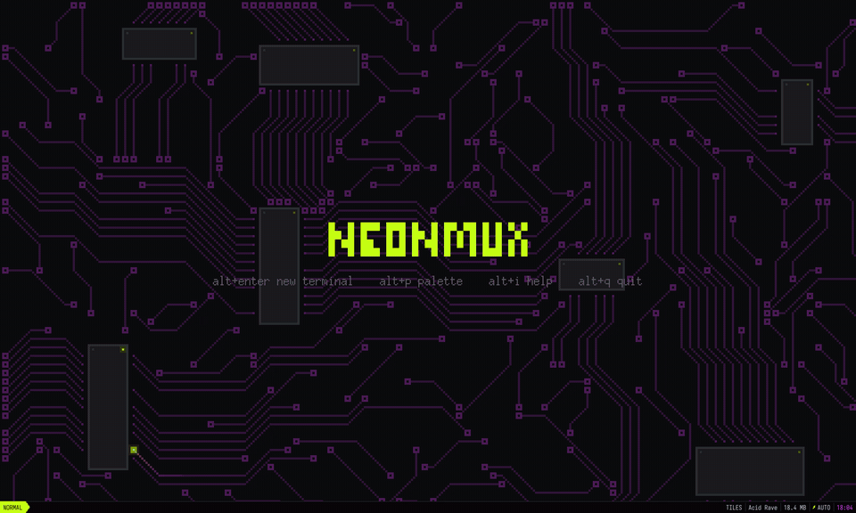
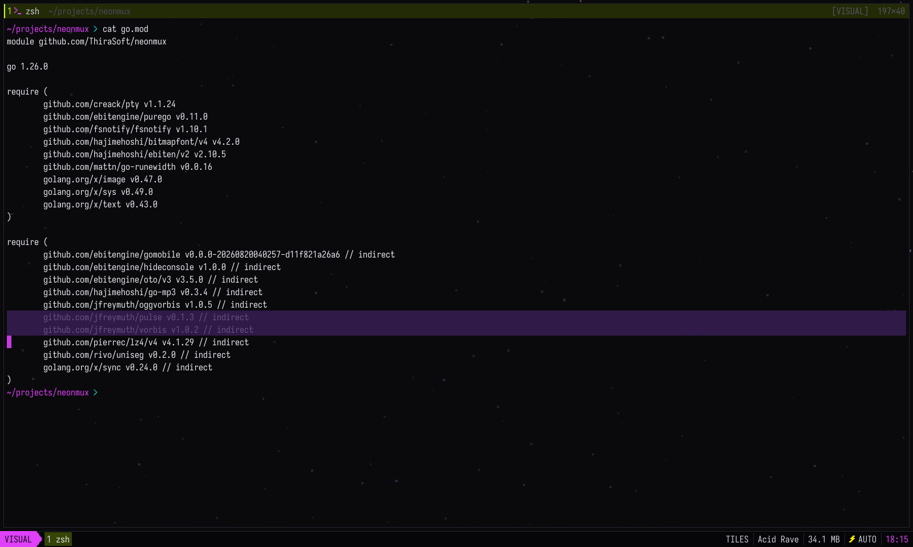

# neonmux

**A terminal multiplexer that keeps an eye on your coding agents, dressed in neon pixel art.**

neonmux is a terminal multiplexer in the spirit of cmux, made for working alongside coding agents and written in Go on the [Ebitengine](https://ebitengine.org) game engine. It knows when Claude Code is waiting for you, and your terminals come back intact after a reboot. Tiled panes in the style of i3 or aerospace, floating panes laid on top, a file explorer that opens right over the pane you are working in, an image viewer and an audio player.

neonmux is a fun side project, made for the pleasure of it.




- **Built for agents.** neonmux notices when Claude Code or another agent is blocked or done, tells you, and takes you there with one key.
- **Sessions that survive.** Terminals keep running when the window closes. After a reboot, each one comes back with its directory, its screen and its nvim or Claude session.
- **Fast and light.** Its own terminal emulator, parsed in Go straight from the PTY, with damage tracking. One static binary with no cgo, Iosevka Term built in. The emulator is a standalone package, [`vt`](vt/), that other Go programs can import.
- **Tiles and floats.** i3-style tiling with four layouts, floating panes you snap to corners, zoom, zen mode, and a garage where panes keep running out of sight.
- **Ten themes, thirteen animated backgrounds**, all switchable on the fly: circuit boards, synthwave grids, Matrix rain, lava lamps, an oscilloscope, a city at night.
- **A few toys**: a typing test fed by Wikipedia and vim kata missions played in the real Neovim.

## Install and run

Prebuilt binaries for Linux and macOS (amd64 and arm64) are attached to each [release](https://github.com/ThiraSoft/neonmux/releases), with a `SHA256SUMS` file to check them. From source:

```sh
./install.sh              # macOS: ~/Applications/neonmux.app (Spotlight, Launchpad, Raycast)
                          # Linux: .desktop entry and icon (rofi, GNOME, KDE)
                          # everywhere: the `neonmux` command in ~/.local/bin
./install.sh --uninstall  # removes everything (config and saved sessions are kept)
```

With the Go toolchain alone:

```sh
go install github.com/ThiraSoft/neonmux@latest
```

This only installs the binary, in `$GOBIN` (`~/go/bin` by default). You get no macOS app bundle and no .desktop entry. On Linux, prefix the command with `CGO_ENABLED=0`, as install.sh does.

Without installing:

```sh
go build -o neonmux .
./neonmux                 # picks up your workspace (the title screen the first time, mod+enter for a terminal)
./neonmux -demo           # a Go file in your editor, a pixel-art image, a chiptune and the file explorer
./neonmux -e "nvim main.go"
./neonmux -version
```

`-demo` writes a small Go program to a private demo folder and opens it in your editor (the `editor` key of the config, otherwise `$EDITOR`, otherwise nvim or vi). Next to it come a pixel-art image and a chiptune, both generated on the fly, and the file explorer opens on top of them.

`-version` prints the version set at link time (`-ldflags "-X main.version=v1.2.3"`). Without it, neonmux prints the module version recorded by `go install`, or for a local build the pseudo-version Go derives from the git commit.

The module needs Go 1.26 (if yours is older, `go` downloads the right toolchain by itself). The binary builds without cgo. Launched from Spotlight or the Finder, neonmux starts in your home directory and finds your login shell even without `$SHELL` in the environment.

## Shortcuts

`mod` is `cmd` on macOS and `alt` on Linux. Every shortcut also exists behind the leader `ctrl+space` (then the key alone), which avoids clashes with aerospace or i3 if your window manager already uses that modifier. Only leader `,` differs: it renames the pane, as in tmux, instead of opening the configuration. Pressing the leader twice sends `ctrl+space` to the program.

If you set `mod` to `ctrl+shift`, a `mod+shift+…` shortcut lands on the same keys as its `mod+…` twin, and the twin wins. Reach it through the leader instead (`ctrl+space` then `shift+f`, for example). The palette and the help always show the key that works.

| Key | Action |
|---|---|
| `mod+enter` | new terminal, opened in the current terminal's directory |
| `mod+e` | file explorer, above the current pane (the same key closes it) |
| `mod+w` | close the pane |
| `mod+h/j/k/l` | focus left, down, up, right |
| `mod+shift+h/j/k/l` | swap the pane with its neighbor |
| `mod+1..9` | focus a pane directly (physical keys, so it also works on AZERTY) |
| `mod+f` | zoom the pane (monocle) |
| `mod+shift+f` | float the pane, or put it back as a tile |
| `mod+a` | move the focus from the tiles to the floating panes, and back |
| `mod+shift+r`, leader `,` or right-click on the header | rename the pane, right in its header (`enter` confirms, `esc` cancels, empty means automatic name) |
| `mod+g` | next layout: tiles, columns, rows, monocle |
| `mod+r` | i3-style resize mode (`h/j/k/l`, `=` to rebalance, `esc` to leave) |
| `mod+u` or leader `[` | vim-style copy mode in the scrollback |
| `mod+p` or leader `:` | fuzzy-search command palette |
| `mod+i` or leader `?` | help: every active shortcut, config included, in a floating pane (`/` filters, `q` closes) |
| `mod+o` | choose a font, built in or installed |
| `mod+t` / `mod+shift+t` | next / previous theme |
| `mod+=` / `mod+-` / `mod+0` | terminal font size: bigger, smaller, default |
| `mod+c` / `mod+v` | copy the selection / paste (bracketed paste if the program asks for it) |
| `mod+n` | go to the next agent or pane waiting for you (blocked first, then done); if it is in the garage, it comes out large in the center |
| `mod+shift+n` | send the pane brought out of the garage back into it, otherwise go back to the previous pane |
| `mod+m` | send the pane to the garage: it keeps running without being shown |
| `mod+d` | go to a pane or an agent, garage included: a list you can filter by project, branch or topic (`mod+w` closes the one you picked) |
| `mod+shift+d` | agent board |
| `mod+shift+g` | diff of the active pane's repository |
| `mod+z` | zen mode: hide every pane, the same key brings them back |
| `ctrl+cmd+f` (macOS) or `f11` | fullscreen, the same key leaves it. It is kept from one launch to the next |
| `mod+b` | next background |
| `mod+.` | performance HUD |
| `mod+,` | open the configuration in your editor |
| `mod+q` | quit: the terminals keep running in the daemon |

A terminal's header shows its name (your own, otherwise the foreground process) followed by its current directory in a dimmer color. When room runs short, the path gets compacted fish style (`~/l/p/console/internal`). Names are saved with the layout and survive closing as well as restarting. A double click on a header zooms the pane.

The default macOS menu grabbed `cmd+h` to hide the application and `cmd+m` to minimize it to the Dock. neonmux removes these shortcuts at startup so that `cmd+h` stays a vim-style move and `cmd+m` sends the pane to the garage.

**Copy mode**: `h j k l`, `w b`, `0 $`, `gg G`, `H M L`, `ctrl+u/d/b/f`, `{ }` (blank lines), `v` (characters), `V` (lines), vim text objects after `v` or `V`: `ip` (paragraph), `iw` (word, paths included), `i(` `ib` `i[` `i{` `iB` `i<` (brackets, across lines), `i"` `i'` `` i` `` (quotes, within the line), each with its `a` form that adds the delimiters or the blanks around; repeated or given a count (`v2iw`, `vi(i(`), an object grows the selection as in vim. Counts work on motions too (`3j`, `2}`). `/` and `?` to search down and up (case ignored unless the pattern has a capital), `n` `N` for the next and previous match, `y` or `enter` to copy, `q` or `esc` to leave.

**File explorer**: it is not a pane. Over a shell waiting at its prompt, it covers that terminal and acts on it. Over a terminal busy with a program (an agent, nvim, a build) or over any other pane, it floats in the center. It closes once its job is done, and `mod+e` brings it back when you need it again.

`j k` to move, `l` or `enter` to open, `h` or `-` to go up, `gg G`, `/` to filter, `.` for hidden files, `~` to go back home, `r` to reload, `y` to copy the path, `o` to open with the system application, `c` to `cd` the shell below into the selected directory (when floating, the last used terminal, and only if it sits at its prompt), `t` to open a new terminal in that directory, `q` or `esc` to close. Images open in the viewer and sounds in the player. Other files open in your editor, right in the shell below when there is one, otherwise in a new pane. What the explorer opens never sends a tile to the garage: when the tiles are full, it floats.

**Image**: `+ -` zoom, `0` fit, `1` actual size, `h j k l` or drag with the mouse to pan, `i` to toggle smoothing, `n p` for the neighboring image, `q` to close. Animated GIFs are supported.

**Floating panes**: a floating pane sits above the tiles, in a corner or anywhere else, and does not take a tile slot (4 floating panes at most). It is handy for keeping a music player or a `btop` in sight while you work.

- `mod+shift+f` floats the active pane in the first free corner (bottom right first), or puts it back as a tile. A pane that has floated before gets its last spot back.
- `mod+a` moves the focus to the last active floating pane, then back to the last tile. From a floating pane, `mod+h/j/k/l` goes to another floating pane if there is one in that direction, otherwise to the tiles.
- `mod+shift+h/j/k/l` snaps the floating pane to the edge of the window. Right then up tucks it into the top right corner.
- `mod+r` on a floating pane opens the `FLOAT` mode: `h j k l` for the size, `H J K L` (or shift and the arrows) for the position, `y u b n` for the four corners like vim's diagonals, `c` for the center, `=` for the default size.
- With the mouse, you move a floating pane by dragging its header (or anywhere while holding `mod`) and resize it by an edge or a corner. Near the edge of the window, it snaps to it.
- `mod+f` on a floating pane enlarges it to the whole window until it loses the focus. A zoomed tile stays zoomed when you move to a floating pane.
- A floating pane tucked into a corner stays there when the window is resized. Its position and size are saved with the layout. The palette also offers "Floating: top right corner" and the other corners.

From a terminal:

```sh
neonmux float                            # toggles this pane between tile and floating
neonmux float -c tr                      # floats it at the top right
neonmux float -c br -s 60x16 neonwave    # runs neonwave in a new 60×16 floating pane, bottom right
```

Corners are written `tl`, `tr`, `bl`, `br` (or `top-left`…) and `center`, the size in columns x rows. The command goes through the login shell to get your `PATH` back, and the pane closes when it ends.

**Zen mode** (`mod+z`): the panes and the bottom bar fade out, leaving only the animated background and the logo. Programs keep running and toasts stay visible (an agent waiting for you still shows up). While an agent is blocked, a frame in the accent color blinks around the window. Input is suspended: only `mod+z` (or `esc`) to come back, `mod+q`, and the background shortcuts such as `mod+b` respond.

**Audio** (mp3, ogg, wav): `space` play/pause, `h l` ±5 s, `H L` ±30 s, `j k` volume, `n p` neighboring track, `v` to switch between spectrum and oscilloscope, `0` back to the start, `q` to close. Clicking the progress bar jumps within the track.

## Agents

neonmux knows what your agents are doing. Claude Code (2.1.295 or later) reports its own state to the terminal through the [Program Status Protocol](https://superlogical.com/rex/docs/build/program-status) (OSC 7501): ready, working along with what it is doing, blocked on a permission or a question, done or failed. neonmux implements this protocol, so there is nothing to set up. Any program that speaks it (Homebrew, Terraform…) benefits as well.

- **Header**: in place of the terminal size, an icon and the agent's state with how long it has been in it ("Running the tests · 42s", "permission: Bash · 4m", "done · 3m"). Its changes since the last commit come first (`+120 −34`), read in the background without ever locking the git index.
- **Bottom bar**: the same icon after each agent's name.
- **When an agent gets blocked** out of your sight, its pane pulses like a notification and a toast says so. When it finishes, a quieter toast ("[2] claude: done", or "failed"), and if its pane is on screen, its border flashes twice so you can tell which one it was (`agent_flash` in the config turns it off or changes the number and length of the flashes). `mod+n` goes to the next one waiting for you, oldest first, and `mod+shift+n` takes you back where you were. Nothing moves on its own.
- **Picker** (`mod+d`): every pane in the palette, agents first from most to least urgent, then the others (terminals, diff, help…), on screen or in the garage. Type part of the project name, the branch or the topic, then `enter`. `mod+w` closes the chosen pane without leaving the list.
- **Agent board** (`mod+shift+d`): a floating pane at the top right that you can keep open. For each agent it shows the state, the directory, the branch and the changes. `enter` goes to the agent, `d` opens its diff, `q` closes.
- **Diff** (`mod+shift+g`, or `neonmux diff [directory]`): the repository's changes since the last commit, new files included, floating over the right half so the agent stays in view. `j k` line, `J K` file, `ctrl+d/u` half page, `enter` opens the editor at that line, `r` reloads, `q` closes. It reloads by itself when an agent in the same repository moves on. `mod+f` enlarges it.
- **Agent on a worktree**: `neonmux agent fix-login "fix the login bug"` runs `claude --worktree fix-login` in a new tile named after the worktree (also from the palette, "New agent on a worktree…"). Claude creates the worktree in `.claude/worktrees/` and offers to keep or delete it when it exits. A shell then stays in that directory. Claude refuses a repository you have never trusted: run `claude` once inside it.

## Garage

To run many agents without showing them all, neonmux separates the panes that run from the panes that are on screen. A pane **in the garage** keeps everything going: its process runs in the daemon, and its agent state, notifications and git counter stay up to date. It is simply neither drawn nor placed in the layout, and it has no number.

- `mod+m` sends the active pane to the garage, tile or floating.
- **Tiles full**: a new pane (`mod+enter`, `neonmux agent`, an opened file…) sends the active tile to the garage instead of stopping it. One `mod+enter` too many no longer kills an agent at work.
- `mod+n` brings a parked agent that is waiting for you out as a large floating pane in the center, above everything else, without touching the layout. The picker (`mod+d`) does the same for any parked pane, and the board (`mod+shift+d`) for agents. The shortcut of the help, the board or the diff also brings its own pane out if it is in the garage.
- Only one pane comes out at a time: bringing out another one sends the previous one back to the garage. The pane brought out stays in the center until you send it back, even after it has had its answer.
- `mod+shift+n` (or `mod+m`) sends it back to the garage, and the focus returns where you were. `mod+shift+f` keeps it on screen: as a tile if one is free, otherwise as a floating pane where it is.
- **Bottom bar**: the visible panes, then "garage 46 · 3 waiting". The summary pulses when a parked agent is blocked. With everything in the garage, the welcome screen reminds you that `mod+d` finds the panes. A parked agent that gets blocked rings like the others: a toast "[garage] claude · question: …" and first place for `mod+n`, the picker and the board.
- `max_panes` only limits the tiles on screen. In total, garage included, neonmux opens at most 64 panes.
- The garage is saved with the layout: after a restart, parked panes reattach to their session without being shown, at the size they had.

The window still decodes the output of every session, garage included. If many very chatty agents end up costing too much, the HUD (`mod+.`) shows the number of panes and how many are in the garage.

## Games

Two small games to pass the time while agents work, both in the palette. Their texts are random sections of the English Wikipedia: the last 50 articles stay in a local cache (`~/Library/Caches/neonmux/wikipedia` on macOS, `~/.cache/neonmux/wikipedia` on Linux) so that you can still play offline. Nothing is fetched until a game opens.

- **Game: typing test**: a typing test in the spirit of monkeytype. Pick a duration (15, 30 or 60 seconds) or a number of words (25, 50, 100) with the arrows before the first key, then type. Wrong letters stay marked, `backspace` fixes them, `alt+backspace` deletes the word, `tab` starts over on a new text. At the end: words per minute, accuracy, raw speed and a speed curve.
- **Game: vim kata**: vim missions in nine chapters (moving, typos, operators, text objects, repeat, counts, moving text, visual block and macros, Ex commands), each one a gesture to learn such as `ci(`, `cgn` or `:g`. You play in the real Neovim (`nvim --clean`, version 0.10 or later, found through your login shell), and the score is the number of keys against a par: the shortest known solution for that very text. At the end, the par is broken down gesture by gesture, which is where you learn something. Three stars at the par or below, two up to one and a half times it; the next chapter opens once 5 missions of the current one have a star. The time is a record of its own and never counts in the stars. `:q` gives up and shows the solution.
- A game comes out large in the center. **As soon as you leave it** (`mod+n` toward an agent, `mod+a`, a click on a tile…) it goes to the garage and its clock stops, so it never hides the agent you went to answer. `mod+shift+n` brings it back where it was.
- Records (best speed per mode, stars, keys and time per mission) are kept in `~/.local/state/neonmux/games.json`.

## Persistent sessions

Terminals do not live in the window but in a small daemon (`neonmux server`), started automatically on first launch and detached from any terminal.

- **Closing the window** (`mod+q`, the red button, end of session) saves the layout and detaches the terminals. A build, a Claude agent or an nvim with unsaved buffers keep running. When you reopen, each pane reattaches to its session and the screen comes back exactly as it is now, scrollback included.
- **Closing a pane** (`mod+w`, or `exit` in the shell) really ends its process.
- **After a reboot**, the processes are gone, but the daemon has saved every terminal to disk (every 15 s if it changed, and at shutdown when the system sends it SIGTERM). On the next launch, each terminal gets its directory back and the old screen stays on display with a line like `── session restored on Oct 21 at 14:32 ──` below it, then a fresh shell starts. The interactive tools in the `restore_commands` list (nvim, vim, less, htop, btop, lazygit…) are relaunched with the same arguments, and `claude` with `--continue` to pick up the conversation. A build, a server or a script is never relaunched automatically.
- A notification (bell, OSC 9, `neonmux notify`) received while the window is closed shows up when you reopen it.

### Restarting on a new version

After `./install.sh`, the palette ("Restart neonmux (window and daemon, new version)") or `neonmux restart` relaunches the window **and** the daemon on the new binary, **without interrupting programs**: a build, nvim or a Claude agent keep running during the switch. The daemon replaces itself with `exec`, keeping its PID (it stays the parent of the shells), its PTYs and its open socket, and hands the state of every terminal over to the new binary. Reading from the PTYs goes through `poll()` and stops before reading anything, so not a single byte is lost. Connections that arrive during the switch wait in the kernel queue. The switch takes about fifty milliseconds.

If the connection to the daemon drops for another reason (a crash), the window reconnects by itself and reattaches to its sessions. The ones the new daemon does not know are restored from disk, as after a reboot.

### Forced restart

`neonmux restart --force` is the way out when something is stuck. It goes through neither the daemon nor the window, so it works even when they no longer answer. It finds the daemon through its socket (the kernel knows the PID of the process listening on it, even a frozen one) and the windows through their PID files. It then collects all their descendants before killing anything, to also catch `nohup` and detached jobs. Windows go first, then the daemon, with SIGTERM first and then SIGKILL after a second and a half for whatever resists. Saved sessions and the layout are erased, the config is kept, and a fresh window starts (`--no-launch` to skip it, `-- args` to pass it options).

Run from a pane, it detaches first, since its own terminal is about to be killed: the report goes to `~/.local/state/neonmux/force.log`. The palette also offers "Force restart (kills every terminal, starts from scratch)". A process group is only killed if its leader is one of the targets, so a window started by a script never takes the script down with it.

```sh
neonmux restart          # window + daemon, hot restart
neonmux restart --force  # kill everything and start from scratch, even when everything is stuck
neonmux restart-server   # the daemon alone
neonmux ls               # terminals kept by the daemon: key, state, process, directory
neonmux -fresh           # start without restoring the saved layout
neonmux -no-server       # terminals tied to the window, with no daemon and no restore
```

One-off launches (`-e`, `-demo`, `-screenshot`) do not use the daemon. The data lives in `~/.local/state/neonmux` (or `$XDG_STATE_HOME/neonmux`): `layout.json` for the window, `terms/<key>.snap` for the terminals' content (the compact scrollback format, about 1 MB for 10,000 lines).

## Prewarmed terminal

An interactive shell with a heavy setup (nvm, conda, compinit, prompt theme…) can take several seconds to start. So neonmux keeps one shell **in reserve**, already initialized: `mod+enter` or `t` in the explorer adopt it instantly, and a new spare gets ready two seconds later.

- The spare starts in the directory of the focused terminal. If the new terminal must open somewhere else, neonmux types ` cd -- 'directory'` (with a leading space) then `ctrl+l`, hides the pane while it redraws, and none of it stays on screen.
- To keep that `cd` out of your history, enable `setopt HIST_IGNORE_SPACE` in your `.zshrc` (`HISTCONTROL=ignorespace` for bash). The automatic relaunch after a reboot goes through the same mechanism.
- The spare is recycled if a shell init file changes (`.zshrc`, `.zprofile`, `.zshenv`, `.bashrc`…) or once it is more than 30 minutes old. It only serves plain shells: an editor or a command always goes through a normal start.
- In the daemon, the spare is ephemeral. It is never saved to disk and it ends when the window closes, even if the window disappears abruptly. `neonmux ls` shows it with the state `spare`.
- Cost: one idle shell (about ten MB, 0% CPU). `"prewarm": false` turns it off.

Measured with a `.zshrc` that took 1.6 s to start: a command typed right after `mod+enter` runs after 1.8 to 1.9 s cold, and after 0.4 s with the spare (0.3 s of which comes from the measuring script itself).

## Configuration

`~/.config/neonmux/config.json` (under `$XDG_CONFIG_HOME` if it is set, or `-config`, or `$NEONMUX_CONFIG`). Missing fields keep their default value. Theme, font, font size, background, typing sparks, window decorations and power mode are written back to it when you change them from the app. Only the changed keys are written, and the others (unknown keys included) stay as they are. Launch options (`-theme`, `-font`, `-size`) only apply to that session. As long as the file has a syntax error, the app writes nothing to it and tells you so. If the file does not exist yet, `mod+,` first writes a complete one with every key and its default value.

The config is **reloaded as soon as it is saved**, for example after `mod+,` opens it in your editor. Theme, fonts, background, pane opacity, power, decorations, shortcuts, shell and prewarm apply on the fly, and a toast lists what changed ("config reloaded: theme, font"). Only `persist` waits for the next launch. A syntax error leaves the running config untouched and points to the offending line. An unknown key is reported without blocking the rest. `scrollback` is capped at 15,000 lines so that a terminal's snapshot stays small enough for the daemon to carry. The file is watched through kqueue or inotify (fsnotify): nothing wakes up while it does not change.

```json
{
  "theme": "acid",
  "font": "iosevka",
  "font_size": 16,
  "ui_font": "iosevka",
  "ui_font_size": 16,
  "symbols_font": "auto",
  "shell": "",
  "leader": "ctrl+space",
  "mod": "cmd",
  "option_as_meta": false,
  "power": "balanced",
  "background": "stars",
  "animate_background": true,
  "scrollback": 10000,
  "max_panes": 4,
  "copy_on_select": true,
  "cursor_blink": true,
  "typing_fx": false,
  "battery": true,
  "editor": "",
  "decorations": true,
  "focus_border": 1,
  "focus_border_alone": false,
  "focus_border_rest": 50,
  "focus_border_fade": 0.35,
  "pane_opacity": 70,
  "persist": true,
  "restore_commands": ["nvim", "vim", "vi", "less", "man", "htop", "btop", "top", "lazygit", "tig", "claude"],
  "prewarm": true,
  "bindings": { "mod+y": "fx.confetti" },
  "agent_flash": true,
  "agent_flash_count": 2,
  "agent_flash_duration": 0.5
}
```

- `font`: the terminal font. `iosevka` (the default) is Iosevka Term, built in. `pixel` is the built-in 6×13 bitmap font, scaled up by whole factors. `gomono` is Go Mono, built in. Anything else is the path of a `.ttf`, `.otf` or `.ttc` file. Characters missing from the font are drawn with the pixel font. A font that cannot be loaded falls back to the pixel font with a toast, and that fallback is never saved. The `mod+o` picker lists the built-in fonts and the monospace fonts installed on the machine.
- `font_size`: size of the terminal font, in points (default 16). `mod+=`, `mod+-` and `mod+0` change it.
- `ui_font`: the interface font (pane headers, bottom bar, palette, toasts, file explorer and audio player). It takes the same values as `font`, `iosevka` by default. The help, the diff and the agent board use the terminal font.
- `ui_font_size`: size of the interface font, in points (default 16).
- `symbols_font`: fallback font for Nerd Font icons (the Unicode private use area). With `auto`, an installed Nerd Font Mono is detected. `none` turns it off, and any other value is the path of a font.
- `shell`: the shell of new terminals. Empty, neonmux uses `$SHELL`, otherwise your login shell.
- `editor`: the command that opens files (explorer, `neonmux open`, diff, `mod+,`, `-demo`). Empty, neonmux uses `$EDITOR`, otherwise nvim, otherwise vi.
- `max_panes`: number of tiles on screen, from 1 to 9 (default 4). Past it, a new pane sends the active tile to the garage.
- `typing_fx`: sparks while typing (default `false`, also from the palette).
- `battery`: the battery level in the bottom bar, with a plug while plugged in and the warning color under 20% (default `true`, also from the palette). It reads IOKit's power sources on macOS and `/sys/class/power_supply` on Linux every 5 seconds in the background, which costs about 60 µs per reading and only redraws the bar when the level or the plug changes. It stays hidden on a machine without a battery.
- `decorations`: `false` removes the macOS title bar and its traffic light buttons (also on the fly from the palette, "Window: macOS decorations on/off"). The window can then no longer be moved with the mouse, which changes nothing if aerospace handles placement.
- `focus_border`: thickness in pixels of the focus border, from 0 to 8 (default 1). At 2 you get the original thick border with its two glows. At 0 the focused pane keeps the normal border. Alone on screen, the focused pane has no focus border, since there is nothing to stand out from. Reloaded on the fly.
- `focus_border_alone`: `true` keeps the focus border even when the pane is alone on screen (default `false`). Reloaded on the fly.
- `focus_border_rest`: intensity of the focus border once it has dimmed, as a percentage (default 50). The border lights up fully on every pane change, then dims down to this intensity. It starts from the normal border, so it always stays brighter than that. At 100 it stays full all the time, which is how you turn the effect off. Reloaded on the fly.
- `focus_border_fade`: how long that dimming takes, in seconds, from 0 to 10 (default 0.35). At 0, the border drops to its resting intensity right away. Reloaded on the fly.
- `pane_opacity`: opacity of the background of terminals and other panes, as a percentage (1 to 100). The lower it is, the more the background shows through behind the text. 70 by default. At 0, each theme keeps its own, between 82 and 96%. Reloaded on the fly.
- `persist`: `false` to go back to terminals tied to the window.
- `option_as_meta` stays `false` by default so that option composes characters (`| { } [ ] ~` on an AZERTY Mac).
- `power`: `eco` (30 fps, still background), `balanced` (60 fps, the background animates as long as the window has the focus, even when you type nothing; shown as AUTO in the bottom bar), `max` (120 fps, always animated).
- `bindings`: your own shortcuts, from a key to an action, on top of the defaults. The help lists them under "Your configuration".
- `agent_flash`: `false` stops the border of an agent that finishes from flashing (default `true`). The toast and the icon in the bottom bar stay. Reloaded on the fly.
- `agent_flash_count`: how many times that border flashes, from 1 to 10 (default 2).
- `agent_flash_duration`: how long each flash lasts, in seconds, from 0.1 to 5 (default 0.5). Raising the count keeps the same rhythm: 4 flashes of 0.5 s last 2 seconds in all.

Available themes: `neon-tokyo`, `synthwave`, `matrix`, `amber`, `ice`, `acid`, `dark-magic`, `blood-moon`, `vaporwave`, `abyss`. **Dark Magic** goes for restraint: a black with a faint violet tint, desaturated hues (amethyst, old gold, sage), over a very faint arcane dust.

Backgrounds (`mod+b` goes to the next one, the palette lists them all):

| Background | What you see |
|---|---|
| `stars` (default) | a drifting star field |
| `grid` | the striped sun and the synthwave grid in perspective (shader) |
| `rain` | katakana rain |
| `dust` | a very faint arcane dust |
| `aurora` | northern lights rippling above mountains and a line of fir trees (shader) |
| `topo` | a living topographic map whose contour lines light up as a sweep passes over them (shader) |
| `lava` | a lava lamp in four shades, as on a limited-palette screen (shader) |
| `fire` | the blaze of 90s demos with its embers, in the theme's colors (a cold flame that turns white on Ice) |
| `life` | the Game of Life on an LED panel, revived by a methuselah when it dies down |
| `swarm` | a murmuration of 300 birds that shimmers when the flock turns, now and then split by a bird of prey |
| `circuit` | a randomly drawn printed circuit board, crossed now and then by flashes jumping from via to via |
| `scope` | an XY oscilloscope with persistent phosphor, gliding from one Lissajous figure to the next |
| `city` | a city at night scrolling in parallax, with its katakana signs and its flying cars |
| `none` | a plain backdrop |

With `auto`, each theme gets its own: `city` for Neon Tokyo, `grid` for Synthwave and Vaporwave, `rain` for Matrix, `scope` for Amber CRT, `aurora` for Ice, `lava` for Acid Rave, `dust` for Dark Magic, `fire` for Blood Moon and `swarm` for Abyss. All backgrounds share the same grain: they are computed at the size of the big pixels and then scaled up without smoothing, and their gradients fall into a few flat colors, as on limited-palette machines. Each one costs between 0.3 and 1 ms per frame at 2560×1600, and shaders are only compiled the first time they are shown.

## Driving neonmux from a terminal

Every shell started by neonmux gets `NEONMUX_SOCK` (the daemon socket), `NEONMUX_PANE` (the pane key) and `NEONMUX_BIN` (the running binary), and the binary's directory is added to `PATH`:

```sh
neonmux open photo.png song.mp3 ~/projects    # each file in the right kind of pane, a directory in the explorer
neonmux notify "build done"                   # pulsing border and badge on this pane
neonmux fx confetti                           # or glitch
neonmux theme synthwave
neonmux rename "api"                          # renames the current pane (empty: automatic name)
neonmux float -c br neonwave                  # neonwave in a floating pane at the bottom right
neonmux diff                                  # diff of the current repository
neonmux agent fix-login "fix the bug"         # Claude on a new worktree
```

To read or drive a pane from another terminal, a script or an agent (the way `tmux capture-pane` and `send-keys` work):

```sh
neonmux ls                                       # pane keys, state, program, directory
neonmux capture nvim                             # the screen of the pane running nvim, as text
neonmux capture 1f3a9c2b7d4e5f60                 # or by its key; with no argument: the current pane
neonmux send-keys nvim escape ":w" enter         # keys for the pane's program
neonmux send-keys api "text:make test" enter wait:2s ctrl+c
```

You designate the pane by its key (`neonmux ls`) or by the name of its foreground program, if it is unique. In `-no-server` mode, `NEONMUX_SOCK` points to the window (`gui-<pid>.sock`, in the daemon's private directory, which only your account can reach) and you can also give the pane's number (the one in the bottom bar). Keys follow the `-script` syntax: a single character, a name (`enter`, `tab`, `escape`, `backspace`, `up`, `down`, `left`, `right`, `home`, `end`, `pageup`, `pagedown`, `space`, `f1`…), a combination (`ctrl+c`, `alt+b`, `shift+tab`) or `text:…` for text. `wait:500ms` adds a pause. `cmd` shortcuts (`super` on Linux) belong to neonmux and are refused. Capture only reads the visible screen, without the scrollback.

A program can also trigger an effect without going through the CLI, with a custom escape sequence: `printf '\e]7777;fx=confetti\a'`. Standard notifications are recognized too (bell, iTerm2's OSC 9 and OSC 777), and so is the OSC 52 clipboard, which is very handy for copying from a remote nvim over SSH. Only the active, visible pane can write to the clipboard: a pane that is hidden, in the garage or behind zen mode is ignored.

An example with Claude Code hooks (`~/.claude/settings.json`), to get the cmux behavior:

```json
{
  "hooks": {
    "Notification": [{ "hooks": [{ "type": "command", "command": "neonmux notify 'Claude is waiting for your answer' 2>/dev/null || true" }] }],
    "Stop": [{ "hooks": [{ "type": "command", "command": "neonmux fx confetti 2>/dev/null || true" }] }]
  }
}
```

## Architecture

```
main.go                  CLI, options, Ebitengine startup
vt                       xterm emulator, usable as a library: parser, grid, compressed scrollback
internal/shell           PTY (creack/pty), foreground process, argv and cwd (libproc via purego, /proc)
internal/server          persistent session daemon, binary protocol, window client
internal/keys            key combinations and their encoding for programs (window and daemon)
internal/gfx             glyph atlas, fonts (Iosevka Term, pixel), procedural drawing, quad batches
internal/fx              frame scheduler, Kage shaders, backgrounds, particles
internal/theme           palettes and mood settings
internal/ui              application: panes, layout, input, composition, palette, IPC
```

Rendering is organized in layers. Only the second one depends on the cell grid, the others are drawn freely, down to the pixel:

0. the background (shader or particles), visible in the gaps and through translucent panes;
1. each terminal's grid, cached in a texture and redrawn line by line;
2. the free content of panes: audio spectrum, images, the explorer's pixel-art icons, cursor, selection;
3. the interface and effects: status bar, toasts, palette, particles, animated layout transitions.



### What keeps CPU and RAM low

- **On-demand rendering.** Ebitengine runs in `FPSModeVsyncOffMinimum` mode. With no event, the loop sleeps in `glfw.WaitEvents`. A scheduler (`internal/fx/pacer.go`) produces a frame when a PTY has received data, at the rate of an active animation, or at a precise moment (cursor blink, end of a toast, the clock's minute), capped at the power mode's rate (60 fps by default). The cursor stops blinking after 15 s of inactivity: all that is left then is one wakeup per minute for the status bar clock. This API has been marked deprecated since Ebitengine 2.5, so it is isolated in `fx.Enable` where it can be replaced.
- **Typing latency.** A key sent to a terminal makes the current frame wait up to 8 ms for the echo to come back (2 to 5 ms with zsh), so the echo shows up in that frame. macOS does not present two frames in the same refresh, which means a separate frame for the echo would push it back to the next one. If the echo is late, the first output that follows an input skips the frame rate cap. TPS is tied to frames (`SyncWithFPS`): at 60 ticks per second, Ebitengine skipped the `Update` of a frame too close to the previous one. Measured from keystroke to end of drawing, the echo goes from about 19 ms down to about 3 ms.
- **Partial rendering.** A pane that changes (cursor, output, audio spectrum) only redraws its own rectangle. The status bar is only redrawn when its content changes.
- **Per-line cache.** Each terminal keeps its grid in a texture and only redraws the lines that changed. The default background stays transparent there, so an animated background never forces the text to be redrawn.
- **12-byte cells.** The rune and the attributes share a `uint32`.
- **Compressed scrollback.** Trailing spaces are dropped, styles are grouped into runs and text is stored as UTF-8: a log line goes from about 1.5 KB to around a hundred bytes. The buffer of an evicted line is reused, so pushing a line allocates nothing once the ring is full (checked by a test).
- **Scrolling without copies.** Line slices are rotated instead of copying cells.
- **Fonts.** Glyphs are rasterized only once, at their final size, into an atlas that starts at 512×512. System fonts are read through `ReaderAt`, without loading the whole file. Box drawing, blocks, braille and Powerline separators are drawn by hand so that they join without a gap from one cell to the next.
- **Lazy resources.** The audio context is only created on first playback. Images over 4096 px are scaled down at decode time. The explorer keeps at most 12 thumbnails in VRAM.
- **Custom parser.** It handles runs of ASCII in one go and parses in the PTY goroutine. Rendering only takes the lock while it builds its vertices.

### The vt package

The terminal emulator lives in its own package, [`vt`](vt/), which other Go programs can import: `github.com/ThiraSoft/neonmux/vt`. It does no I/O and no drawing. You feed it what a program writes, it keeps the screen, the scrollback and the modes, and you read the cells back. When the width changes, it rewraps the screen and the history, so a long line stays whole after you shrink then widen a pane. It also tracks the kitty keyboard protocol, and neonmux encodes keys accordingly: a program that asks for it, such as nvim, can tell `ctrl+i` from `tab` or `shift+enter` from `enter`. Its only dependency outside the standard library is go-runewidth.

```go
term := vt.New(80, 24, 10000)            // columns, rows, scrollback lines
term.SetReply(func(b []byte) { pty.Write(b) }) // answers to queries (cursor position, colors…)
term.Write(output)                        // bytes read from the PTY
for _, line := range term.ScreenText() {
	fmt.Println(line)
}
```

The package documentation covers concurrency (one writer, readers under `Lock`), snapshots and the limitations.

## Measurements

Apple M3 Mac, macOS 26.3, 1600×960 window on an external display (scale factor 1). CPU is the CPU time actually consumed (`ps`) divided by the duration. Memory is the macOS footprint (`footprint`, the value Activity Monitor shows), which includes GPU memory.

| Scenario | CPU | Footprint |
|---|---|---|
| Idle, 1 shell | 0.10% | 71 MB |
| Reference: fresh Alacritty, 1 window | 0.07% | 37 MB |
| Background animated nonstop (max mode, 30 fps) | 7.6% | 143 MB |
| 4-pane demo, audio spectrum at 30 fps | 11.6% | 136 MB |
| Endless stream (`cat` in a loop) | ~100% of one core | 152 MB |

Throughput: `cat` of a 50 MB file of colored logs takes **0.43 s** in neonmux against **0.45 s** in Alacritty. The parser alone handles about 170 MB/s (`go test -bench Flood ./vt`).

At rest, the gap with Alacritty mostly comes from the Go runtime (~19 MB) and from the offscreen image Ebitengine keeps between two frames. During animations, the CPU profile shows 80% of the time going into Ebitengine's encoding of Metal commands (purego calls into Objective-C). neonmux's own code weighs less than 5%. During continuous rendering, the Metal driver also reserves about fifty MB of extra GPU buffers.

### What about Tauri or Wails?

I have not measured them here: the figures below are orders of magnitude, not measurements.

- **RAM.** On macOS, a WKWebView starts several processes (WebContent, GPU, Networking), and you would have to add four xterm.js instances with their scrollback. Count on something like 150 to 300 MB across all processes, against 70 to 85 MB here at rest.
- **Heavy throughput.** Tauri and Wails both push every byte from the PTY through their IPC bridge (serialization) before JavaScript parses it and then draws it. Here the parsing happens in Go, directly in the PTY goroutine. The advantage is clear as soon as a build or a log pours out a lot of text.
- **Idle.** A webview is event-driven and uses almost nothing at rest. A game loop started with a handicap there, and on-demand rendering makes up for it (0.1%).
- **Animations.** Ebitengine gives access to shaders and to free rendering down to the pixel. The same result on the web would need WebGL and a canvas layered over the terminal.

### How the window reattaches to the daemon

The daemon owns the PTYs and one `vt.Terminal` per session. When the window reattaches, the daemon takes a full snapshot of the terminal (grids, scrollback, cursors, modes, and even the parser state if it is in the middle of an escape sequence) under the same lock as the PTY read, then sends the raw stream. The window's terminal interprets that stream identically, without ever answering the program (only the daemon answers DA, DSR or OSC 11 requests). Resizes are written into the same stream so both sides stay in sync. A window that is too slow gets disconnected rather than slowing programs down, and it reattaches with a fresh snapshot.

The full cycle is covered by an integration test that runs the real binary: creation, detach, reattach, SIGTERM, restore in a new daemon, shutdown (`go test ./internal/server`).

## Linux

The binary builds without cgo for amd64 and arm64: Ebitengine loads X11 and OpenGL dynamically, and sound goes through a PulseAudio client written in Go. At runtime you need:

- an X server or XWayland, and the X11 and OpenGL (Mesa) libraries present on any desktop;
- PulseAudio or PipeWire (with pipewire-pulse) for sound;
- `wl-copy` or `xclip` for the clipboard.

`mod` is `alt` by default, to leave `super` to i3 or sway (you can change it with `"mod"`). The daemon socket lives in `$XDG_RUNTIME_DIR`. The terminal, PTY and daemon tests pass in a Linux container, and the interface has been checked under Xvfb with software OpenGL rendering. It is also used daily on Arch Linux under KDE Plasma (Wayland).

## Known limitations

- A combining mark is only kept when it composes with the previous character into a single one (e followed by an acute accent gives é). Other marks are dropped, and emoji ZWJ sequences show component by component. No color emoji and no ligatures.
- No graphics protocol (sixel, kitty): images go through `neonmux open`.
- Kitty keyboard protocol: only its first level (disambiguate escape codes). No key release events.
- Drag and drop only opens images and sounds (including those inside a dropped folder).
- No accessibility support (VoiceOver).
- A session is shown in only one window at a time: opening a second one takes the session over.

## License

neonmux is released under the MIT license (see [LICENSE](LICENSE)). The embedded fonts keep their own license, the SIL Open Font License 1.1: Iosevka in [internal/gfx/iosevka/](internal/gfx/iosevka/). The licenses of the Go modules and fonts compiled into the binary are collected in [THIRD_PARTY_LICENSES.md](THIRD_PARTY_LICENSES.md).

If you use neonmux in your work or build on it, [CITATION.cff](CITATION.cff) explains how to cite it (GitHub shows a "Cite this repository" button).
