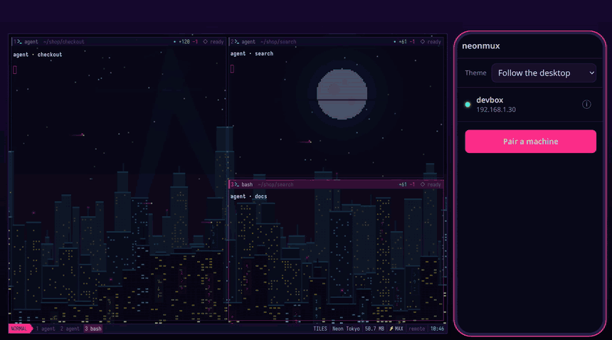
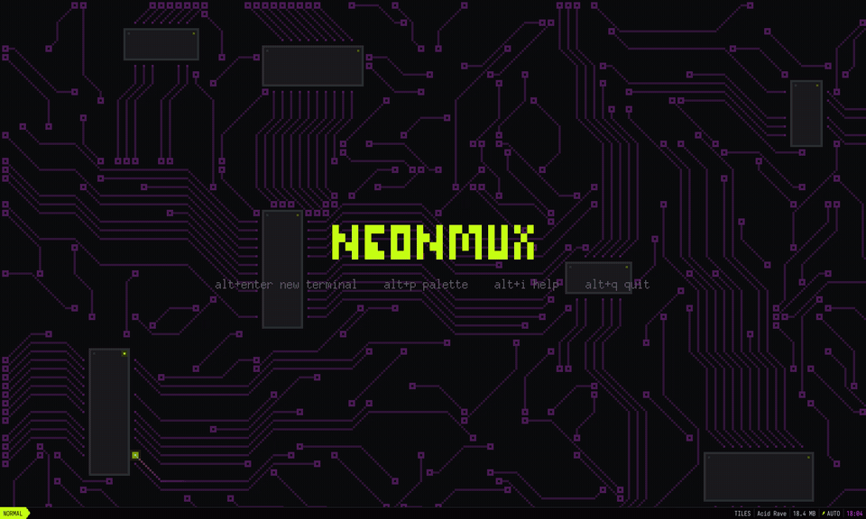

# neonmux

**A terminal multiplexer for coding agents. It tells you when one is stuck and lets you answer from your phone, in neon pixel art.**



<sub>A stand-in agent keeps the demo short, and the phone app runs in a browser at phone size. The terminals, the status protocol, the pairing and the connection are the real ones. [Video version](docs/agent-phone.mp4).</sub>

- **Images in your terminals.** The kitty graphics protocol: icat, yazi, image.nvim and snacks.nvim show real images, which stay through scrolling, the garage and restarts, and show on your phone too.
- **It knows what your agents are doing.** Claude Code reports its state out of the box, and so does any program that speaks the [Program Status Protocol](https://superlogical.com/rex/docs/build/program-status). When one is blocked or done, neonmux tells you and takes you there with one key.
- **Your terminals on your phone.** Answer an agent from the couch: an iPhone app served by your own machine and connected straight to it, paired by QR code, unlocked with Face ID.
- **Reboots don't lose your place.** Terminals keep running when the window closes. After a reboot, each one comes back with its directory, its screen and its nvim or Claude session.
- **Agents can drive it too.** From any shell, a script or an agent reads the window as JSON, types shortcuts, waits for a pane and takes a PNG of what is on screen. A [skill](skills/neonmux/SKILL.md) teaches it to Claude Code: `cp -r skills/neonmux ~/.claude/skills/`.
- **Tiles, floats and a garage.** i3-style tiling, floating panes, zoom, and a garage where panes keep running out of sight.
- **Ten themes, thirteen animated backgrounds.** A city at night, synthwave grids, Matrix rain, lava lamps, northern lights.
- **More than terminals.** A file explorer that opens over your pane, an image viewer, an audio player with a spectrum, and a web browser in a pane.
- **Toys for the wait.** A typing test and vim kata missions played in the real Neovim.
- **One binary.** No cgo, Iosevka Term built in, and its own terminal emulator, [`vt`](vt/), that other Go programs can import.



neonmux is a fun side project, made for the pleasure of it. If it made you smile, a star is very welcome.

## Try it

Prebuilt binaries for Linux and macOS (amd64 and arm64) are attached to each [release](https://github.com/ThiraSoft/neonmux/releases), with a `SHA256SUMS` file to check them. From source:

```sh
./install.sh              # macOS: ~/Applications/neonmux.app  Linux: .desktop entry
                          # everywhere: the `neonmux` command in ~/.local/bin
./install.sh --uninstall  # removes everything (config and saved sessions are kept)
```

With the Go toolchain alone (Go 1.26; on Linux, prefix it with `CGO_ENABLED=0`):

```sh
go install github.com/ThiraSoft/neonmux@latest
```

Then:

```sh
neonmux -demo             # a Go file in your editor, a pixel-art image, a chiptune and the file explorer
neonmux                   # your workspace (the title screen the first time, mod+enter for a terminal)
```

On Linux you need X11 or XWayland, OpenGL (Mesa), PulseAudio or PipeWire for sound and `wl-copy` or `xclip` for the clipboard. It is used daily on Arch under KDE Plasma, and on macOS.

## The ten shortcuts to start with

`mod` is `cmd` on macOS and `alt` on Linux. Everything also exists behind the leader `ctrl+space`.

| Key | |
|---|---|
| `mod+enter` | new terminal |
| `mod+h/j/k/l` | move the focus |
| `mod+n` | next agent waiting for you |
| `mod+d` | picker: every pane, agents first |
| `mod+shift+f` | float the pane, or put it back |
| `mod+m` | send the pane to the garage |
| `mod+e` | file explorer |
| `mod+t` | next theme |
| `mod+z` | zen mode |
| `mod+p` | command palette, `mod+i` for help |

All of them, with copy mode and every kind of pane: [docs/shortcuts.md](docs/shortcuts.md).

## Answer from your phone

Pick a terminal, read it, type into it, with blocked agents first in the list. It works with the window closed. **You need an iPhone with a recent iOS, and [Tailscale](https://tailscale.com) on at least one of your machines** to serve the app over HTTPS.

Whoever gets this channel types into your shells, so security comes first. It is off by default and listens on private addresses only. The phone pins the machine's certificate and signs every connection with a Face ID passkey, and a pairing only goes through once you confirm its code on the desktop. Nothing shows behind Face ID when you come back to the app. [How it is secured, and how to set it up](docs/remote.md).

## Looks


## Going further

- [Agents and the garage](docs/agents.md): the header, the toasts, the board, running many agents at once
- [Phone](docs/remote.md): setup, security, commands
- [Sessions](docs/sessions.md): what survives what, restarting on a new version
- [Shortcuts and panes](docs/shortcuts.md): copy mode, explorer, browser, floating panes, workspaces
- [Configuration](docs/configuration.md): every key, the themes, the backgrounds
- [Scripting](docs/scripting.md): `neonmux open`, `send-keys`, effects from a shell, driving the window from a script or an agent ([skill](skills/neonmux/SKILL.md))
- [Games](docs/games.md): typing test and vim kata
- [Architecture](docs/architecture.md): how it is built, and the `vt` package

## Known limitations

- A combining mark is only kept when it composes with the previous character into a single one (e followed by an acute accent gives é). Other marks are dropped, and emoji ZWJ sequences show component by component. No color emoji and no ligatures.
- No sixel, no animation. Kitty graphics images are always drawn above the text (z < 0 is not honored), and only full-screen scrolls move images (scroll regions do not).
- Kitty keyboard protocol: only its first level (disambiguate escape codes). No key release events.
- Drag and drop only opens images and sounds (including those inside a dropped folder).
- No accessibility support (VoiceOver).
- A session is shown in only one window at a time: opening a second one takes the session over.

## License

neonmux is released under the MIT license (see [LICENSE](LICENSE)). The embedded fonts keep their own license, the SIL Open Font License 1.1: Iosevka in [internal/gfx/iosevka/](internal/gfx/iosevka/). The licenses of the Go modules and fonts compiled into the binary are collected in [THIRD_PARTY_LICENSES.md](THIRD_PARTY_LICENSES.md).

If you use neonmux in your work or build on it, [CITATION.cff](CITATION.cff) explains how to cite it (GitHub shows a "Cite this repository" button).
