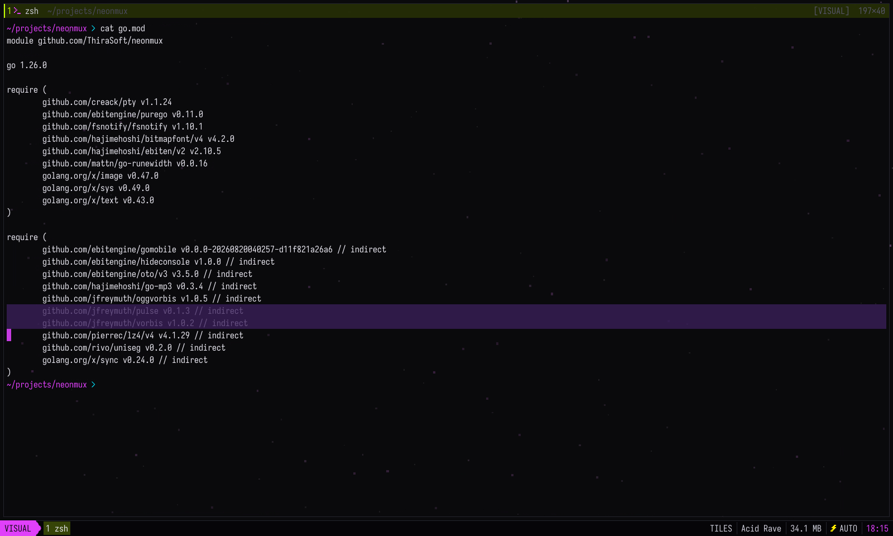

# Architecture

How neonmux is put together.

```
main.go                  CLI, options, Ebitengine startup
vt                       xterm emulator, usable as a library: parser, grid, compressed scrollback, kitty graphics
internal/shell           PTY (creack/pty), foreground process, argv and cwd (libproc via purego, /proc)
internal/server          persistent session daemon, binary protocol, window client
internal/remote          remote control from a phone: WebTransport server, pairing, passkeys, screen frames, the PWA
internal/keys            key combinations and their encoding for programs (window and daemon)
internal/gfx             glyph atlas, fonts (Iosevka Term, pixel), procedural drawing, quad batches
internal/fx              frame scheduler, Kage shaders, backgrounds, particles
internal/theme           palettes and mood settings
internal/ui              application: panes, layout, input, composition, palette, IPC
```

Rendering is organized in layers. Only the second one depends on the cell grid, the others are drawn freely, down to the pixel:

0. the background (shader or particles), visible in the gaps and through translucent panes;
1. each terminal's grid, cached in a texture and redrawn line by line;
2. the free content of panes: audio spectrum, images, the explorer's pixel-art icons, cursor, selection;
3. the interface and effects: status bar, toasts, palette, particles, animated layout transitions.



### Why it feels smooth

- **It only draws what changes.** With nothing going on, the window sleeps. A pane that changes redraws its own rectangle, and a terminal only the lines that moved, so an animated background never forces the text to be redrawn.
- **Typing comes first.** A keystroke holds its frame for a moment, so the echo lands in that frame rather than one refresh later.
- **Long scrollback stays cheap.** Trailing spaces go, styles become runs and text is stored as UTF-8.
- **Clean lines.** Box drawing, blocks, braille and Powerline separators are drawn by hand, so they join without a gap from one cell to the next.

### How the window reattaches to the daemon

The daemon owns the PTYs and one `vt.Terminal` per session. When the window reattaches, the daemon takes a full snapshot of the terminal (grids, scrollback, cursors, modes, kitty images and placements, and even the parser state if it is in the middle of an escape sequence) under the same lock as the PTY read, then sends the raw stream. The window's terminal interprets that stream identically, without ever answering the program (only the daemon answers DA, DSR or OSC 11 requests). Resizes are written into the same stream so both sides stay in sync. A window that is too slow gets disconnected rather than slowing programs down, and it reattaches with a fresh snapshot.

The full cycle is covered by an integration test that runs the real binary: creation, detach, reattach, SIGTERM, restore in a new daemon, shutdown (`go test ./internal/server`).

### The vt package

The terminal emulator lives in its own package, [`vt`](../vt/), which other Go programs can import: `github.com/ThiraSoft/neonmux/vt`. It does no I/O and no drawing. You feed it what a program writes, it keeps the screen, the scrollback and the modes, and you read the cells back. When the width changes, it rewraps the screen and the history, so a long line stays whole after you shrink then widen a pane. It also tracks the kitty keyboard protocol, and neonmux encodes keys accordingly: a program that asks for it, such as nvim, can tell `ctrl+i` from `tab` or `shift+enter` from `enter`. Outside the standard library it depends on go-runewidth and on `golang.org/x/text/unicode/norm`.

It supports the kitty graphics protocol: direct transmissions and placements (chunked transfers, optional zlib decompression, 24-bit RGB, 32-bit RGBA and PNG payloads), file transmissions read by the daemon and sent inline to the window, and Unicode placeholders (`U+10EEEE` with diacritics) for snacks.nvim and image.nvim. Placements stick to lines and scroll with the text into the scrollback history. Images survive scrolling, the garage, window reattachment and daemon restarts (carried by snapshots), and show on the phone. Direct placements are queried via `VisiblePlacements`, while placeholder cells decode through `Cell.Placeholder` and `PlaceholderSlice`. Remaining limits: no sixel, no animation, images are always drawn above the text (z < 0 not honored), and only full-screen scrolls move images (scroll regions do not).

```go
term := vt.New(80, 24, 10000)            // columns, rows, scrollback lines
term.SetReply(func(b []byte) { pty.Write(b) }) // answers to queries (cursor position, colors…)
term.Write(output)                        // bytes read from the PTY
for _, line := range term.ScreenText() {
	fmt.Println(line)
}
```

The package documentation covers concurrency (one writer, readers under `Lock`), snapshots and the limitations.

## Building

`-version` prints the version set at link time (`-ldflags "-X main.version=v1.2.3"`). Without it, neonmux prints the module version recorded by `go install`, or for a local build the pseudo-version Go derives from the git commit.

The module needs Go 1.26 (if yours is older, `go` downloads the right toolchain by itself). The binary builds without cgo. Launched from Spotlight or the Finder, neonmux starts in your home directory and finds your login shell even without `$SHELL` in the environment.
