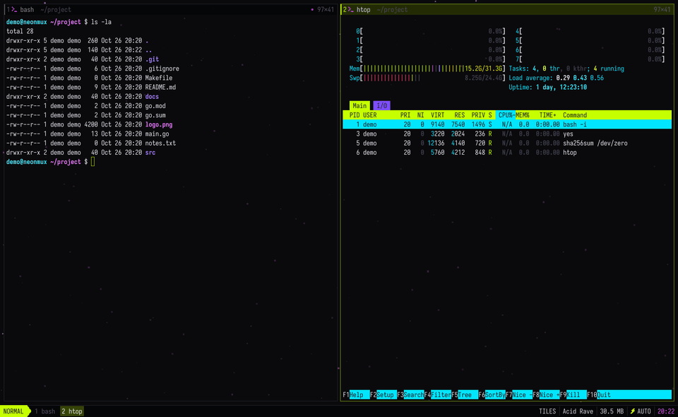

# Shortcuts and panes

Every shortcut, and how each kind of pane behaves. `mod+i` shows the same list inside neonmux.

`mod` is `cmd` on macOS and `alt` on Linux. Every shortcut also exists behind the leader `ctrl+space` (then the key alone), which avoids clashes with aerospace or i3 if your window manager already uses that modifier. Only leader `,` differs: it renames the pane, as in tmux, instead of opening the configuration. Pressing the leader twice sends `ctrl+space` to the program.

If you set `mod` to `ctrl+shift`, a `mod+shift+…` shortcut lands on the same keys as its `mod+…` twin, and the twin wins. Reach it through the leader instead (`ctrl+space` then `shift+f`, for example). The palette and the help always show the key that works.

| Key | Action |
|---|---|
| `mod+enter` | new terminal, opened in the current terminal's directory |
| `mod+e` | file explorer, above the current pane (the same key closes it) |
| `mod+w` | close the pane |
| `mod+h/j/k/l` | focus left, down, up, right (in monocle, `h` and `l` go through the tiles in number order) |
| `mod+shift+h/j/k/l` | swap the pane with its neighbor |
| `mod+1..9` | show workspace 1 to 9, from the top row or the keypad (physical keys, so it also works on AZERTY) |
| `mod+shift+1..9` | send the pane to workspace 1 to 9 |
| `mod+f` | zoom the pane (monocle) |
| `mod+shift+f` | float the pane, or put it back as a tile |
| `mod+a` | move the focus from the tiles to the floating panes, and back |
| `mod+shift+r`, leader `,` or right-click on the header | rename the pane, right in its header (`enter` confirms, `esc` cancels, empty means automatic name) |
| `mod+g` | next layout: tiles, columns, rows, monocle |
| `mod+r` | i3-style resize mode (`h/j/k/l`, `=` to rebalance, `esc` to leave) |
| `mod+u` or leader `[` | vim-style copy mode in the scrollback |
| `mod+p` or leader `:` | fuzzy-search command palette |
| `mod+i` or leader `?` | help: every active shortcut, config included, in a floating pane (`/` filters, `q` closes) |
| `mod+o` | choose a font, built in or installed |
| `mod+t` / `mod+shift+t` | next / previous theme |
| `mod+=` / `mod+-` / `mod+0` | terminal font size: bigger, smaller, default |
| `mod+c` / `mod+v` | copy the selection / paste (bracketed paste if the program asks for it) |
| `mod+n` | go to the next agent or pane waiting for you (blocked first, then done); if it is in the garage, it comes out large in the center |
| `mod+shift+n` | send the pane brought out of the garage back into it, otherwise go back to the previous pane |
| `mod+m` | send the pane to the garage: it keeps running without being shown |
| `mod+d` | go to a pane or an agent, garage included: a list you can filter by project, branch or topic (`mod+w` closes the one you picked) |
| `mod+shift+d` | agent board |
| `mod+shift+e` | prompter: agent replies word by word |
| `mod+shift+g` | diff of the active pane's repository |
| `mod+z` | zen mode: hide every pane, the same key brings them back |
| `mod+y` | braille view: the text in 8-dot braille (toasts, palette, help and the file explorer stay in plain text), the same key brings it back |
| `ctrl+cmd+f` (macOS) or `f11` | fullscreen, the same key leaves it. It is kept from one launch to the next |
| `mod+b` | browser: open an address or search in a new pane |
| `mod+shift+b` | next background |
| `mod+.` | performance HUD |
| `mod+,` | open the configuration in your editor |
| `mod+q` | quit: the terminals keep running in the daemon |

A terminal's header shows its name (your own, otherwise the foreground process) followed by its current directory in a dimmer color. When room runs short, the path gets compacted fish style (`~/l/p/console/internal`). Names are saved with the layout and survive closing as well as restarting. A double click on a header zooms the pane.

The default macOS menu grabbed `cmd+h` to hide the application and `cmd+m` to minimize it to the Dock. neonmux removes these shortcuts at startup so that `cmd+h` stays a vim-style move and `cmd+m` sends the pane to the garage.



**Copy mode**: `h j k l`, `w b e ge` and `W B E gE`, `0 ^ $`, `f F t T` with `;` `,` (on the line), `%` (matching bracket, across lines), `gg G`, `H M L`, `ctrl+u/d/b/f`, `{ }` (blank lines), `v` (characters), `V` (lines), vim text objects after `v` or `V`: `ip` (paragraph), `iw` (word, paths included), `iW` (any run of non-blanks), `i(` `ib` `i[` `i{` `iB` `i<` (brackets, across lines), `i"` `i'` `` i` `` (quotes, within the line), each with its `a` form that adds the delimiters or the blanks around; repeated or given a count (`v2iw`, `vi(i(`), an object grows the selection as in vim. Counts work on motions too (`3j`, `2}`). `/` and `?` to search down and up (case ignored unless the pattern has a capital), `n` `N` for the next and previous match, `*` `#` for the word under the cursor (whole word, case ignored), `y` or `enter` to copy, `q` or `esc` to leave.

**File explorer**: it is not a pane. Over a shell waiting at its prompt, it covers that terminal and acts on it. Over a terminal busy with a program (an agent, nvim, a build) or over any other pane, it floats in the center. It closes once its job is done, and `mod+e` brings it back when you need it again.

`j k` to move, `l` or `enter` to open, `h` or `-` to go up, `gg G`, `/` to filter, `.` for hidden files, `~` to go back home, `r` to reload, `y` to copy the path, `o` to open with the system application, `c` to `cd` the shell below into the selected directory (when floating, the last used terminal, and only if it sits at its prompt), `t` to open a new terminal in that directory, `q` or `esc` to close. Images open in the viewer and sounds in the player. Other files open in your editor, right in the shell below when there is one, otherwise in a new pane. What the explorer opens never sends a tile to the garage: when the tiles are full, it floats.

**Image**: `+ -` zoom, `0` fit, `1` actual size, `h j k l` or drag with the mouse to pan, `i` to toggle smoothing, `n p` for the neighboring image, `q` to close. Animated GIFs are supported.

**Browser**: a pane that shows a web page, rendered by a headless Brave, Chromium, Chrome, Edge or Vivaldi already on the machine. `mod+b` asks for an address: a URL, a bare host (`go.dev`, `localhost:8080`), a path (`~/site/index.html`) or anything else, which goes to DuckDuckGo. The same palette lists the bookmarks of the browsers on the machine (Brave, Chromium, Chrome, Edge, Vivaldi, every profile, read only): typing filters them, `↑ ↓` picks one, and `enter` opens the selected bookmark once the selection has moved, otherwise what you typed. Your own bookmarks come first, with a star: `ctrl+d` in the pane, or the star at the right of the bar, adds the page or removes it, and `mod+w` in the palette forgets the selected one. They live in `bookmarks.json`, next to the config, a plain list of names and addresses you can edit by hand. The browsers' files are never written. In the pane, the mouse, the wheel and the keyboard go to the page. `ctrl+l` or a click on the address types another one, `alt+←` `alt+→` go back and forward, `ctrl+r` or `f5` reloads, and the `‹ › ↻` buttons of the bar do the same. `mod+c` copies the page's selection and `mod+v` pastes into it. A link that opens a new window opens in the same pane. The page follows the pane's size and prefers a dark look. Sound plays, even from a pane out of sight (garage, another workspace, monocle): music goes on from the garage. Such a pane only stops streaming its frames until it comes back. While a video plays, frames come at one pixel per CSS pixel and a lower JPEG quality, which keeps it smoother at the cost of some sharpness. Video is still not as smooth as in a real browser: every frame is a JPEG that goes through the pipe. One browser serves every pane: it starts with the first one and quits with the last. It is driven over a pipe (`--remote-debugging-pipe`), never a network port, and keeps its own profile under neonmux's state directory, so logins stay from one launch to the next. Your own browser's passwords and history are not there. The browser comes from the `browser` key of the config, otherwise the first one found, Brave first, then the Chromium that Playwright downloads. Flatpak and Snap builds are not used: their sandbox does not pass the pipe through. Browser panes come back after a restart on the page they showed.

**Floating panes**: a floating pane sits above the tiles, in a corner or anywhere else, and does not take a tile slot (4 floating panes at most). It is handy for keeping a music player or a `btop` in sight while you work.

- `mod+shift+f` floats the active pane in the first free corner (bottom right first), or puts it back as a tile. A pane that has floated before gets its last spot back.
- `mod+a` moves the focus to the last active floating pane, then back to the last tile. From a floating pane, `mod+h/j/k/l` goes to another floating pane if there is one in that direction, otherwise to the tiles.
- `mod+shift+h/j/k/l` snaps the floating pane to the edge of the window. Right then up tucks it into the top right corner.
- `mod+r` on a floating pane opens the `FLOAT` mode: `h j k l` for the size, `H J K L` (or shift and the arrows) for the position, `y u b n` for the four corners like vim's diagonals, `c` for the center, `=` for the default size.
- With the mouse, you move a floating pane by dragging its header (or anywhere while holding `mod`) and resize it by an edge or a corner. Near the edge of the window, it snaps to it.
- `mod+f` on a floating pane enlarges it to the whole window until it loses the focus. A zoomed tile stays zoomed when you move to a floating pane.
- A floating pane tucked into a corner stays there when the window is resized. Its position and size are saved with the layout. The palette also offers "Floating: top right corner" and the other corners.

From a terminal:

```sh
neonmux float                            # toggles this pane between tile and floating
neonmux float -c tr                      # floats it at the top right
neonmux float -c br -s 60x16 neonwave    # runs neonwave in a new 60×16 floating pane, bottom right
```

Corners are written `tl`, `tr`, `bl`, `br` (or `top-left`…) and `center`, the size in columns x rows. The command goes through the login shell to get your `PATH` back, and the pane closes when it ends.

**Workspaces**: nine sets of panes, one shown at a time, as in cmux or i3. Each workspace keeps its own tiles, floating panes, layout and zoom. Panes of a hidden workspace keep running, and an agent waiting there still sends its toast. The bottom bar lists the workspaces in use as soon as you leave the first one: the one shown is highlighted, and one where an agent waits is in the warning color (it pulses when the agent is blocked). `mod+n`, the picker and the agent board take you to the right workspace. The garage is shared by all of them. Workspaces are saved with the layout.

**Zen mode** (`mod+z`): the panes and the bottom bar fade out, leaving only the animated background and the logo. Programs keep running and toasts stay visible (an agent waiting for you still shows up). While an agent is blocked, a frame in the accent color blinks around the window. Input is suspended: only `mod+z` (or `esc`) to come back, `mod+q`, and the background and theme shortcuts such as `mod+shift+b` and `mod+t` respond.

**Audio** (mp3, ogg, wav): `space` play/pause, `h l` ±5 s, `H L` ±30 s, `j k` volume, `n p` neighboring track, `v` to switch between spectrum and oscilloscope, `0` back to the start, `q` to close. Clicking the progress bar jumps within the track.
